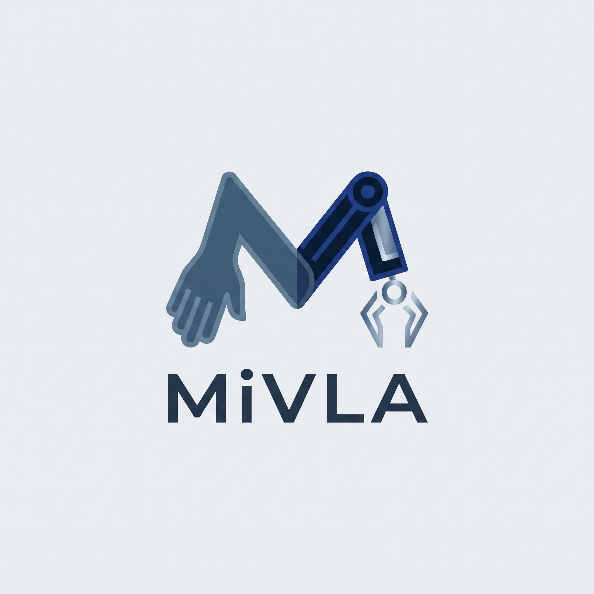
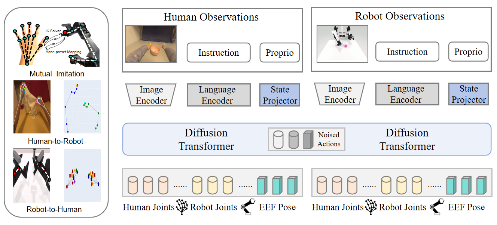

### Towards Generalizable Vision-Language-Action Model with Human-Robot Mutual Imitation Pre-training

**CVPR 2026 Findings**

[Paper (arXiv)](https://arxiv.org/abs/2512.15411) · [Pretrained model (ModelScope)](https://modelscope.cn/models/Yinzhenhan/MiVLA) · [CVPR 2026 Findings poster](https://cvpr.thecvf.com/virtual/2026/poster/40664) · [Project homepage](https://mivla-research.github.io/) · [Citation](#citation)

MiVLA is a vision-language-action (VLA) model trained with **human-robot mutual imitation**. It uses egocentric human demonstrations and simulated robot demonstrations to learn complementary behavioral priors before adapting to target robot tasks. The contribution is a bidirectional human-robot action mapping and a cross-embodiment pre-training objective; the underlying diffusion Transformer backbone and software environment remain unchanged.

## Highlights

- **Bidirectional action alignment.** Kinematic transforms map human hand motion to robot end-effector motion and map robot demonstrations back to a human-hand representation.
- **Mutual imitation pre-training.** For each demonstration, MiVLA predicts actions for the observed embodiment and complementary actions for the other embodiment.
- **Unified action representation.** The 76D training representation combines 48D human-hand joints, 14D robot joints, and 14D end-effector poses.
- **Cross-embodiment evaluation.** The paper evaluates RoboTwin 2.0 and three physical robot platforms: PiPER, ARX, and LocoMan.

## Results

The following numbers are reported in the paper. Simulation results are averages over the **20 tasks selected for the main RoboTwin 2.0 comparison**; physical robot results are averages over three downstream tasks after task-specific fine-tuning.

| Evaluation | Metric | MiVLA |
| --- | --- | ---: |
| RoboTwin 2.0, easy mode (20 tasks) | Success rate | 69% |
| RoboTwin 2.0, hard mode (20 tasks) | Success rate | 66% |
| Physical robots: PiPER, ARX, LocoMan (3 tasks) | Full-task success rate | 55% |
| Physical robots: PiPER, ARX, LocoMan (3 tasks) | Subtask completeness | 69% |

The physical robot experiments use **30 expert demonstrations per task for fine-tuning**. The human-video and simulated-robot data are used in pre-training; the physical robot numbers are not zero-shot deployment results. See the [paper](https://arxiv.org/abs/2512.15411) for per-task comparisons and ablations.

Visit the [MiVLA project homepage](https://mivla-research.github.io/) for more about the project.

## Repository layout

| Path | Purpose |
| --- | --- |
| [models/](models/) | Vision, language, and diffusion action model implementations |
| [datasets/](datasets/) | EgoDex, RoboTwin 2.0, and physical robot dataset loaders |
| [data_process/](data_process/) | Human-robot action conversion and preprocessing scripts |
| [configs/](configs/) | Training and model configurations |
| [inference/robotwin2_example/](inference/robotwin2_example/) | RoboTwin 2.0 inference example |
| [inference/real_example/](inference/real_example/) | Physical robot inference example |
| [web/](web/) | Project visuals and assets |

## Pretrained Model

The MiVLA pretrained model is available on [ModelScope](https://modelscope.cn/models/Yinzhenhan/MiVLA). Use a checkpoint compatible with the configuration and action representation selected for training or inference.

## Installation

Use the existing Python 3.10 environment and dependency versions:

~~~bash
git clone https://github.com/zhenhanyin/MiVLA.git
cd MiVLA
conda create -n mivla python=3.10
conda activate mivla
pip install -r requirements.txt
~~~

Training and inference require the corresponding datasets and a compatible checkpoint. The pretrained MiVLA model is hosted on ModelScope; the repository does not include the raw EgoDex or RoboTwin 2.0 datasets or checkpoint weights.

## Data preparation

### EgoDex human demonstrations

Prepare the [EgoDex](https://arxiv.org/abs/2505.11709) dataset and update the data and T5 model paths in [datasets/pretrain/setup_pretrain.sh](datasets/pretrain/setup_pretrain.sh). The human-data preprocessing pipeline is:

~~~bash
source datasets/pretrain/setup_pretrain.sh
bash datasets/pretrain/run_pretrain_pipeline.sh
~~~

This pipeline generates human action annotations, statistics, and language embeddings. For joint human-robot pre-training, also inspect the 76D dataset loader in [datasets/co_pretrain_v2/](datasets/co_pretrain_v2/) and the conversion scripts in [data_process/](data_process/).

### RoboTwin 2.0 robot demonstrations

Prepare the RoboTwin 2.0 demonstrations and set the dataset paths in [datasets/robotwin2/setup_robotwin2.sh](datasets/robotwin2/setup_robotwin2.sh) and [datasets/dataset.py](datasets/dataset.py). Precomputed language embeddings for RoboTwin tasks are included in the repository. The [RoboTwin data notes](datasets/robotwin2/README.md) describe how to regenerate them if needed.

## Training

The repository provides example launchers for the main stages:

| Stage | Launcher |
| --- | --- |
| Human-robot co-pre-training | [Pretrain_co_pretrain_V2_76d.sh](Pretrain_co_pretrain_V2_76d.sh) |
| RoboTwin 2.0 fine-tuning | [finetune_robotwin_76d_with_noise.sh](finetune_robotwin_76d_with_noise.sh) |
| Physical robot fine-tuning | [finetune_real_76d_selective_14d_joint.sh](finetune_real_76d_selective_14d_joint.sh) |
| Two-arm physical robot example | [two_arms_real_16d_from_v3.sh](two_arms_real_16d_from_v3.sh) |

**Before running a launcher:** replace machine-specific absolute paths, dataset roots, checkpoint paths, CUDA device IDs, network interface settings, and output directories with values for your system. Check that the selected configuration matches the action dimensions and checkpoint you intend to use. The co-pre-training launcher currently points to a configuration filename that is not present in this checkout; [configs/pretrain_76d.yaml](configs/pretrain_76d.yaml) is the included 76D pre-training configuration to review when adapting it. These scripts are research examples and require local configuration.

## Inference

See the [RoboTwin 2.0 inference instructions](inference/robotwin2_example/README.md) and the [physical robot example](inference/real_example/). Supply a compatible checkpoint and update the paths and task settings for your target platform.

## Citation

If you use MiVLA in your research, please cite the **CVPR 2026 Findings** paper:

~~~bibtex
@inproceedings{yin2026mivla,
  title     = {MiVLA: Towards Generalizable Vision-Language-Action Model with Human-Robot Mutual Imitation Pre-training},
  author    = {Yin, Zhenhan and Wang, Xuanhan and Jiang, Jiahao and Deng, Kaiyuan and Chen, Pengqi and Li, Shuangle and Liu, Chong and Xu, Xing and Song, Jingkuan and Gao, Lianli and Shen, Heng Tao},
  booktitle = {Proceedings of the IEEE/CVF Conference on Computer Vision and Pattern Recognition (CVPR) Findings},
  year      = {2026},
  url       = {https://cvpr.thecvf.com/virtual/2026/poster/40664}
}
~~~

## Contact

For questions about the paper or repository, contact [yinzhenhan06@gmail.com](mailto:yinzhenhan06@gmail.com).

## License

This repository is released under the [Mozilla Public License 2.0](LICENSE).
